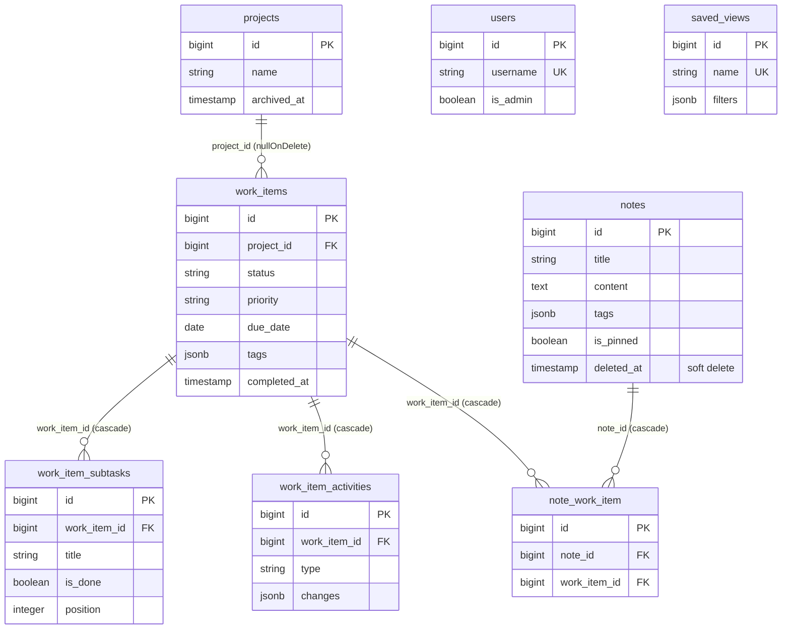

# Arsitektur My Workspace

Dokumen ini adalah ringkasan navigator. Untuk aturan kerja, checklist, dan
spesifikasi fitur, rujuk `AGENT_CONTEXT.md` (terutama §5, §6, §8, §10, §12, §19)
dan `FEATURES.md`. Keputusan arsitektural tercatat di [`adr/`](adr/README.md).

## Gambaran sistem

Aplikasi personal, lokal, dan pribadi untuk mengelola catatan Markdown,
pekerjaan, dan proyek. Satu proses Laravel melayani halaman Inertia/React serta
endpoint JSON kecil; tidak ada layanan mikro atau API publik terpisah.

| Lapisan | Pilihan |
| --- | --- |
| Backend | PHP 8.2+, Laravel 12 |
| Frontend | React 19 + Inertia v2 |
| Build | Vite 7, Tailwind CSS v4, komponen shadcn/ui (Radix) |
| Database runtime | PostgreSQL, database `my_workspace` |
| Database test | SQLite `:memory:` via `phpunit.xml` |
| Test browser | Playwright + Chromium, SQLite terpisah |
| Backup | `php artisan db:backup` (`pg_dump`) + scheduler harian |

### Alur request

```
Browser
  → routes/web.php (middleware web; grup /admin memakai admin.auth)
  → Controller (validasi + Eloquent)
  → Inertia::render('admin/<page>', props)  atau JsonResponse
  → resources/js/pages/admin/** (React, AdminLayout)
  → mutation via router.post/put/patch/delete + flash success → toast
```

Rute PWA (`/manifest.webmanifest`, `/sw.js`, `/offline.html`) dilayani langsung
dari `public/` oleh closure di `routes/web.php`. Entry aplikasi adalah `/`
(halaman login admin), bukan `/dashboard` bawaan starter kit. Lihat §6
`AGENT_CONTEXT.md` untuk detail alur dan §10 untuk konvensi controller/query.

### Autentikasi admin

`AdminAuthController` memakai `Auth::attempt` dengan `username`, `password`, dan
`is_admin = true`; login dibatasi `throttle:10,1`. Group rute `/admin`
dilindungi alias `admin.auth` (`EnsureAdminAuthenticated`) yang mengalihkan ke
`/` bila pengguna tidak login atau bukan admin. Akun awal dibuat oleh
`AdminUserSeeder` dari `config/admin.php` (env `ADMIN_*`). Fortify terpasang
tetapi tidak terhubung ke UI admin — lihat known issues di §19 `AGENT_CONTEXT.md`.

## Peta modul

| Modul | Controller | Tampilan / fakultas utama |
| --- | --- | --- |
| Catatan | `NoteController` | Daftar + pencarian + filter tag + arsip, dialog editor/detail Markdown, pin, tautan ke pekerjaan |
| Pekerjaan | `WorkItemController`, `SavedViewController` | Daftar, Papan Kanban (drag ubah status), Kalender bulanan, subtask, saved view, aksi massal |
| Proyek | `ProjectController` | CRUD, arsip, progress dari `withCount` |
| Dashboard | `AdminController` | Statistik, agenda, grafik aktivitas 7/30 hari, statistik pengetahuan |
| Data | `AdminDataController` | Export JSON/Markdown, import dengan pratinjau |
| Notifikasi | `NotificationController` | Endpoint JSON tenggat hari ini/ besok/ terlambat, dikelompokkan di header |
| Pencarian | `SearchController` | Endpoint JSON global (5 catatan + 5 pekerjaan teratas) untuk command palette |
| Backup | `DatabaseBackupCommand` | `db:backup` via `pg_dump`, retensi 14, scheduler harian |

Detail workflow produk ada di §14 `AGENT_CONTEXT.md`; spesifikasi yang sudah
selesai ada di `docs/specs-done.md`. Panduan backup/restore:
[`docs/backup-restore.md`](backup-restore.md). Bukti dan keputusan indeks:
[`docs/query-review.md`](query-review.md).

## Relasi data



`saved_views` berdiri sendiri (preset filter, tanpa FK). `users` tidak memiliki
foreign key ke tabel domain; kaitannya hanya lewat sesi/`is_admin`. Definisi
kolom lengkap dan index ada di §8 `AGENT_CONTEXT.md`.

## Strategi testing

- **Pest + SQLite in-memory** (`phpunit.xml`, `RefreshDatabase`, helper
  `adminUser()`): menguji controller, props Inertia, validasi, dan aksi tulis.
  Semua query harus kompatibel PostgreSQL dan SQLite; verifikasi PostgreSQL
  dilakukan terpisah secara manual. Lihat §12 `AGENT_CONTEXT.md`.
- **Playwright + Chromium** (`npm run e2e`): enam skenario browser untuk
  menangkap error React yang tidak terlihat Pest. Memakai `database/e2e.sqlite`
  yang di-gitignore, kredensial dummy yang dibuat saat setup, penjaga database
  di `global-setup.js`, dan webServer port 8001 dengan build production.
  Tidak masuk `scripts/check.sh` maupun CI. Lihat §12 `AGENT_CONTEXT.md`.
- **Quality gate:** `bash scripts/check.sh` (Pint, ESLint, Prettier, Pest, build).

## Konteks pemakaian

Aplikasi ini dijalankan di mesin sendiri untuk kebutuhan pribadi, bukan produk
yang dideploy ke server publik. Fitur yang butuh layanan eksternal/biaya (berita
AI, agen, deployment) ditunda atau dibatalkan; lihat §19 `AGENT_CONTEXT.md` dan
antrean di `FEATURES.md`. Konsekuensinya: satu akun admin, backup lokal via
`pg_dump`, dan tidak ada ekspektasi multi-tenant atau akses publik.
